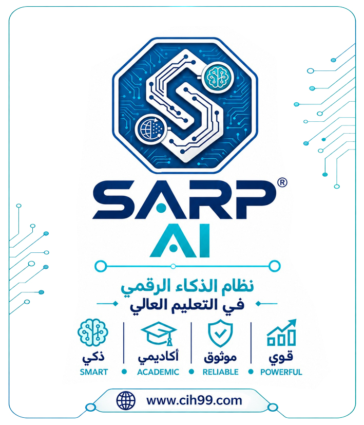

# SARP® AI
## Student Affairs and Registration Project Artificial Intelligence
### نظام الذكاء الرقمي لإدارة شؤون الطلبة والتسجيل

**Digital Transformation • Digital Intelligence • Artificial Intelligence**  
**التحول الرقمي • الذكاء الرقمي • الذكاء الاصطناعي**

[Official Website](https://sarp.cih99.com) ·
[GitHub Wiki](https://github.com/CiH99ITSecurity/SARP-AI/wiki) ·
[Releases](https://github.com/CiH99ITSecurity/SARP-AI/releases) ·
[Discussions & User Feedback](https://github.com/CiH99ITSecurity/SARP-AI/discussions)

---

## 🇮🇶 نبذة عن النظام | About SARP AI

**سارب SARP® AI** هو اختصار لـ **Student Affairs and Registration Project Artificial Intelligence**، وهو نظام مخصص للمساعدة في تصميم وطباعة وثائق التخرج والشهادات والتأييدات لطلبة الدراسات الأولية والخريجين، مع التركيز على سرعة التنفيذ وأمن المعلومات وتدفق البيانات.

**SARP® AI** stands for **Student Affairs and Registration Project Artificial Intelligence**. The system is designed to help prepare and print graduation documents, certificates, and endorsements for undergraduate students and graduates, with an emphasis on execution speed, information security, and data flow.

> للحصول على التفاصيل الكاملة والمعلومات التكميلية، يُرجى الرجوع إلى [الويكي الرسمي للمشروع](https://github.com/CiH99ITSecurity/SARP-AI/wiki).  
> For further details and supporting information, please refer to the [official project Wiki](https://github.com/CiH99ITSecurity/SARP-AI/wiki).

## ✨ معلومات النظام | System Information

| البند | التفاصيل |
|---|---|
| اسم النظام / System name | SARP® AI |
| الاسم الكامل / Full name | Student Affairs and Registration Project Artificial Intelligence |
| المطوّر / Developer | Haider D. Abd, CiH99 IT Security, Inc. |
| المنصة / Platform | Microsoft Windows, Microsoft Office |
| اللغات / Languages | العربية والإنجليزية / Arabic and English |
| تاريخ الإصدار الأول / Initial release date | 4 April 2021 |
| الإصدار المذكور في معلومات المستودع / Release shown in repository information | SARPAI v24.4.4.13 |
| الموقع الرسمي / Official website | [sarp.cih99.com](https://sarp.cih99.com) |
| حقوق المصدر / Source rights | Copyright reserved — جميع الحقوق محفوظة |

*ملاحظة / Note: الإصدار أعلاه هو الإصدار المذكور في معلومات المستودع الحالية، وليس تأكيدًا على أحدث إصدار متاح خارج المستودع.*  
*The version above is the one currently stated in the repository information; it is not a claim that no newer version exists elsewhere.*

## 📥 التحميل والتثبيت | Download & Installation

- **صفحة الإصدارات / Releases page:** [SARP AI Releases](https://github.com/CiH99ITSecurity/SARP-AI/releases)
- **ملفات المشروع / Repository files:** [Browse repository files](https://github.com/CiH99ITSecurity/SARP-AI)

**قبل التثبيت / Before installation:** يُرجى مشاهدة فيديوهات التثبيت أولًا.  
Please watch the installation videos before installing the system.

- [Installation video 1](https://www.youtube.com/watch?v=jN2BUSWZhRY)
- [Installation video 2](https://youtu.be/5fMlJIVczOY?feature=shared)
- [Video playlist / قائمة الفيديوهات](https://www.youtube.com/playlist?list=PLijG1jBpJM-D8owNAwFrX8pi98V1O50Kd)

## 🌐 الروابط الرسمية | Official Links

- **الموقع الرسمي / Official website:** [sarp.cih99.com](https://sarp.cih99.com)
- **الدعم / Support:** [SARP Support](https://sarp.cih99.com/Support/)
- **شركة CiH99 IT Security:** [cih99.com](https://www.cih99.com)
- **قناة المطوّر / Developer channel:** [Haider D. Abd — YouTube](https://www.youtube.com/@hdatechtips)
- **GitHub Wiki:** [دليل ومعلومات المشروع / Project documentation](https://github.com/CiH99ITSecurity/SARP-AI/wiki)

## 💬 آراء المستخدمين والدعم | User Feedback & Support

يمكنكم مشاركة آرائكم وتجاربكم واقتراحاتكم أو طرح الأسئلة في مناقشات GitHub الخاصة بالمشروع.  
Share your experience, feedback, suggestions, or questions in the project's GitHub Discussions.

- [⭐ User Reviews / آراء المستخدمين](https://github.com/CiH99ITSecurity/SARP-AI/discussions)
- [Questions & Answers / الأسئلة والأجوبة](https://github.com/CiH99ITSecurity/SARP-AI/discussions)
- [Report a technical issue / الإبلاغ عن مشكلة تقنية](https://github.com/CiH99ITSecurity/SARP-AI/issues)

للملاحظات عبر البريد الإلكتروني / For feedback by email: **sarp@cih99.com**

## 🔑 التفعيل والتواصل | Activation & Contact

للاستفسار عن مفتاح التفعيل، تشير معلومات المستودع إلى إمكانية التواصل عبر واتساب على الرقم التالي:  
For activation-key enquiries, the repository information lists the following WhatsApp contact:

**WhatsApp:** `00964-7901976385`

## 🔐 الترخيص والأمان | License & Security

- يُرجى مراجعة ملف [LICENSE.txt](https://github.com/CiH99ITSecurity/SARP-AI/blob/main/LICENSE.txt) لمعرفة شروط الترخيص وحقوق الاستخدام.  
  Please review [LICENSE.txt](https://github.com/CiH99ITSecurity/SARP-AI/blob/main/LICENSE.txt) for licensing terms and usage rights.
- يُرجى مراجعة [SECURITY.md](https://github.com/CiH99ITSecurity/SARP-AI/blob/main/SECURITY.md) للاطلاع على سياسة الأمان.  
  Please review [SECURITY.md](https://github.com/CiH99ITSecurity/SARP-AI/blob/main/SECURITY.md) for the security policy.
- **حقوق المصدر محفوظة / Source rights reserved.** لا تفترض أن المشروع مفتوح المصدر؛ راجع ملف الترخيص قبل إعادة الاستخدام أو إعادة التوزيع.  
  Do not assume the project is open source; consult the license before reuse or redistribution.

---

**SARP® AI — Student Affairs and Registration Project Artificial Intelligence**  
**نظام الذكاء الرقمي لإدارة شؤون الطلبة والتسجيل**

[الموقع الرسمي / Official Website](https://sarp.cih99.com)

